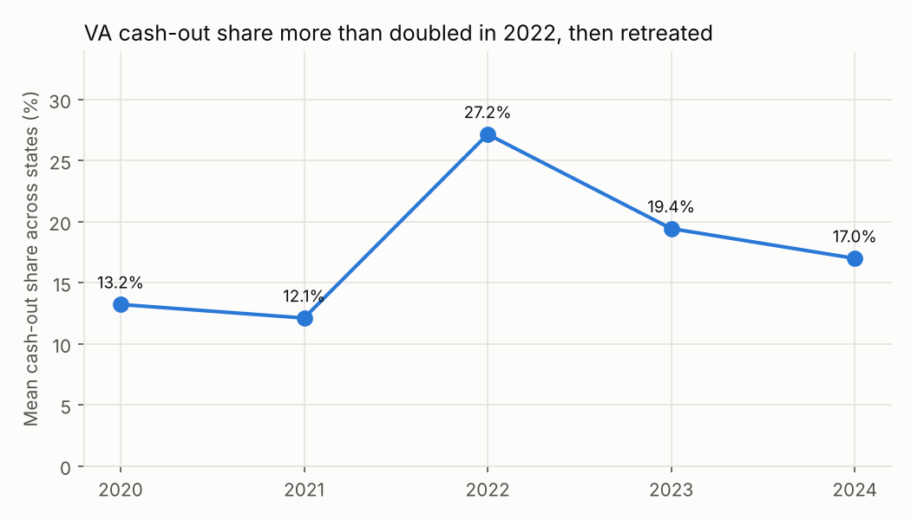
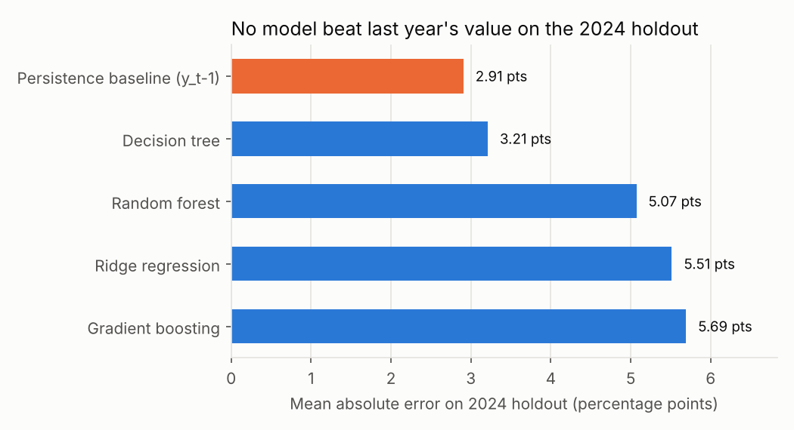
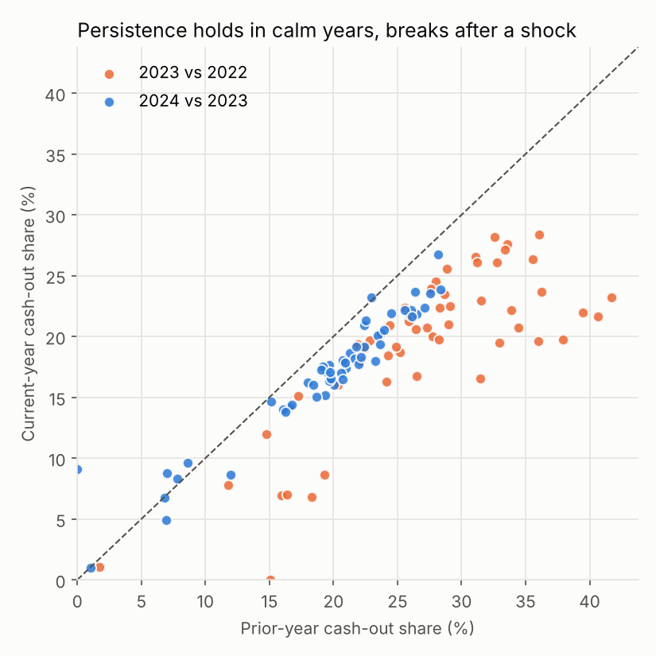
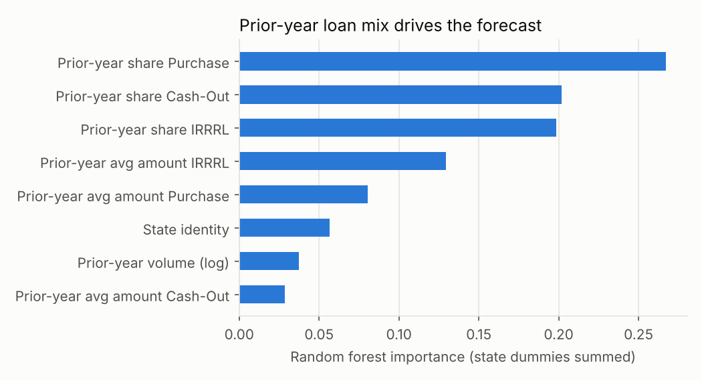

# Forecasting VA Cash-Out Refinance Share Across States

**Can machine learning predict which states will see more veterans pulling equity out of their homes next year, and can it beat simply assuming next year looks like this year?**

D'Andre Burdin | M.S. Data Science, Hawaii Pacific University (DSCI 6800)

## Key findings

| | |
|---|---|
| **The 2022 spike** | Mean state cash-out share jumped from **12.1% in 2021 to 27.2% in 2022**, then fell back to 17.0% by 2024. Idaho, Arizona, and California topped 39%. |
| **Persistence wins in calm years** | On the 2024 holdout, "same as last year" had the lowest error (MAE **2.91 pts**, R² 0.58). No tuned model beat it. |
| **Models win after a shock** | Forecasting 2023, right after the spike, persistence collapsed (R² -0.95). Ridge regression cut its error nearly in half (MAE **4.18 vs 7.72 pts**). |
| **What drives the forecast** | The prior year's loan mix (purchase, cash-out, and IRRRL shares) dominates; state identity adds little. |



**Why it matters:** cash-out share swings with rate cycles. When rates rose in 2022, veterans who could no longer benefit from rate-and-term refinancing turned to cash-out loans instead. A lender or agent planning capacity can lean on last year's numbers in a stable market, but needs a model when the market turns.

## Data

VA "Loan Volume by State" reports, 2020 to 2024: **54 states and territories x 5 years = 270 state-year records**, with loan counts, shares, and average amounts for Purchase, IRRRL, and Cash-Out loans. Aggregate public data only, with no borrower-level information.

## Methodology

- **Target:** cash-out share of VA loans for state *s* in year *t*
- **Predictors:** lag-1 (prior-year) loan shares, average loan amounts, and volume, plus a state one-hot encoding. Nothing from year *t* is used, so the setup is leak-free.
- **Baseline:** persistence, predicting this year's share as last year's
- **Models:** Ridge regression, decision tree, random forest, gradient boosting
- **Time-aware tuning:** hyperparameters are chosen on training years only (fit on earlier years, validate on the latest training year), never on the test year
- **Out-of-time testing:** main test trains on 2021 to 2023 and evaluates once on 2024; a rolling-origin check also trains through 2022 and tests on 2023
- **Extension:** "change" models that predict the year-over-year move on top of persistence

## Results

**Main test: train 2021 to 2023, holdout 2024**

| Model | MAE | RMSE | R² |
|---|---|---|---|
| **Persistence baseline** | **0.0291** | **0.0328** | **0.584** |
| Decision tree | 0.0321 | 0.0382 | 0.437 |
| Random forest | 0.0507 | 0.0547 | -0.156 |
| Ridge regression | 0.0551 | 0.0599 | -0.383 |
| Gradient boosting | 0.0569 | 0.0613 | -0.450 |



**Rolling-origin check: what happens in a transition year**

| Test year | Persistence MAE | Best model | Best model MAE |
|---|---|---|---|
| 2023 (after the spike) | 0.0772 | Ridge regression | **0.0418** |
| 2024 (stabilizing) | **0.0291** | Random forest, change target | 0.0297 |

<p float="left">
  
  
</p>

In 2024 the points hug the diagonal, so last year is a strong guess. In 2023 nearly every state fell below it as the 2022 spike unwound, and that broad mean reversion is what the models picked up.

## Limitations

- **Small sample:** 54 states per test year. The 2023 result is a single transition year and should be read as suggestive, not settled.
- **Internal features only:** no mortgage rates, house prices, or unemployment yet. The literature review argues these drive regime shifts, and adding them is the clearest next step.
- **Aggregate data:** state-level patterns should not be read as individual borrower behavior.

## Repository structure

```
├── src/forecast_cashout_share.py   # Full pipeline: features, tuning, testing, importance, figures
├── data/va_state_year.xlsx         # State-year panel (wide)
├── data/va_state_year_long.xlsx    # Same data, one row per loan type
├── outputs/                        # Results tables, run log, feature importance, SHAP values
│   └── figures/
└── docs/report.pdf                 # Course report with full literature review
```

## Reproduce it

```bash
pip install -r requirements.txt
python src/forecast_cashout_share.py
```

**Note on the report:** `docs/report.pdf` is the course submission and contains the full literature review (refinancing option theory, borrower inattention, equity extraction, debt substitution). The code in this repo is a clean, tuned rebuild of the methods it describes. The tuned models score better than the untuned results in the report's Table III, and the persistence baseline here (MAE 0.0291) differs slightly from the report's 0.0281, which came from an earlier version of the data. The conclusion is unchanged: persistence is the model to beat in stable years.

## Tools

Python, pandas, scikit-learn, SHAP, matplotlib

## Contact

[LinkedIn](https://www.linkedin.com/in/d-andre-burdin-m-s-d-s-82136bb7/) | [VA loan approval ML capstone](https://github.com/dburdin32/va-loan-approval-fairness) | [SQL projects](https://github.com/dburdin32/sql-data-cleaning-projects)
